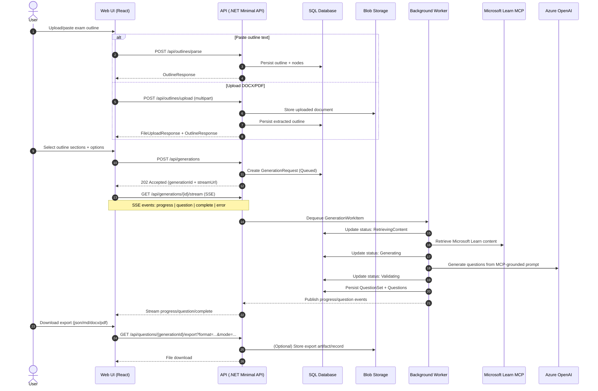

<p align="center">
  
</p>

<h1 align="center">AI Exam Forge</h1>

<p align="center">
  AI-powered exam question generator using Microsoft Learn content through Model Context Protocol (MCP).
</p>

<p align="center">
  <a href="#overview">Overview</a> •
  <a href="#quickstart">Quickstart</a> •
  <a href="#azure-deployment">Azure Deployment</a> •
  <a href="#architecture">Architecture</a> •
  <a href="#documentation">Documentation</a>
</p>

---

## Overview

AI Exam Forge generates high-quality practice exam questions by leveraging Microsoft Learn documentation through the Model Context Protocol (MCP). All question content is derived exclusively from official Microsoft documentation, ensuring accuracy and alignment with certification exam objectives.

### Key Features

- **MCP-Powered Content**: All questions are sourced from Microsoft Learn documentation
- **Multiple Question Types**: Supports various item types including multiple choice, drag-and-drop, and build list
- **Quality Validation**: Automated lint validation ensures compliance with exam writing standards
- **Export Formats**: Export questions as JSON, Markdown, DOCX, or PDF
- **Study/Exam Modes**: Toggle between study mode (with explanations) and exam mode (without)

---

## Quickstart

### Prerequisites

| Tool | Version | Purpose |
|------|---------|---------|
| .NET SDK | 10.0+ | Backend runtime |
| Node.js | 20.19+ LTS | Frontend tooling |
| Azure CLI | Latest | Cloud resource management |
| Git | Latest | Version control |

### Local Setup

#### 1. Clone Repository

```bash
git clone https://github.com/swigerb/AIExamForge.git
cd AIExamForge
```

#### 2. Build the solution

```bash
dotnet restore
dotnet build
```

Edit `backend/src/AIExamForge.Api/appsettings.json` with your Azure service endpoints (or provide them via environment variables / Key Vault).

Optional: create a local-only override file at `backend/src/AIExamForge.Api/appsettings.Development.json` (this file is gitignored).

```json
{
  "AzureOpenAI": {
    "Endpoint": "https://your-openai.openai.azure.com/",
    "DeploymentName": "gpt-4-turbo",
    "ApiKey": "your-api-key"
  },
  "BlobStorage": {
    "ConnectionString": "UseDevelopmentStorage=true"
  }
}
```

Environment variable alternatives (recommended for local dev):

- `AzureOpenAI__Endpoint`
- `AzureOpenAI__DeploymentName`
- `AzureOpenAI__ApiKey`

#### 3. Run API

```bash
# From repo root:
cd backend/src/AIExamForge.Api
dotnet run

# API available at: http://localhost:5180
# OpenAPI document (Development only): http://localhost:5180/openapi/v1.json
# HTTPS is available via the "https" launch profile if you want it.
```

#### 4. Frontend Setup

```bash
cd frontend
npm install
echo "VITE_API_BASE_URL=http://localhost:5180/api" > .env.development
npm run dev

# App available at: http://localhost:5173
```

Note: `frontend/.env.development` is gitignored. Use it for your local API URL.

### Verify Setup

```bash
# Backend health check
curl http://localhost:5180/health
```

### Running Tests

```bash
# Backend tests
dotnet test

# Frontend tests
cd frontend
npm test
```

Frontend tests are executed with Vitest.

### Common Issues

| Issue | Solution |
|-------|----------|
| Database connection failed | Ensure SQL Server LocalDB is installed and running |
| Azurite connection failed | Run `azurite --silent` in a separate terminal |
| MCP service unavailable | Verify network connectivity to Microsoft Learn |
| Azure OpenAI rate limited | Wait for reset or increase TPM quota |

---

## Azure Deployment

AIExamForge is configured for deployment using the [Azure Developer CLI (azd)](https://learn.microsoft.com/azure/developer/azure-developer-cli/).

### Prerequisites

1. **Azure Developer CLI** - Install from [aka.ms/azd-install](https://aka.ms/azd-install)
2. **Azure subscription** - With permissions to create resources
3. **.NET 10.0 SDK** - For building the backend
4. **Node.js 20.x** - For building the frontend

### Deploy with `azd up`

The `azd up` command provisions all Azure resources and deploys the application in a single step:

```bash
# Login to Azure
azd auth login

# Initialize and deploy (first time)
azd up
```

You'll be prompted to:
- Select an Azure subscription
- Choose a deployment region
- Provide an environment name (e.g., `dev`, `prod`)

### What Gets Deployed

| Resource | Description |
|----------|-------------|
| **Azure App Service** | Hosts the .NET API backend |
| **Azure Static Web App** | Hosts the React frontend |
| **Azure OpenAI Service** | Powers question generation (GPT-4) |
| **Azure Key Vault** | Securely stores secrets and API keys |
| **Azure Storage Account** | Stores uploaded outlines and generated content |
| **Application Insights** | Monitoring and diagnostics |
| **Log Analytics Workspace** | Centralized logging |

### Common `azd` Commands

```bash
azd deploy              # Deploy code changes only (skip infrastructure)
azd show                # View deployed resources
azd monitor --overview  # Open the deployed application in browser
azd down                # Tear down all resources
azd env set VAR value   # Set environment variables
azd env list            # View current environment
```

### Environment Configuration

After deployment, configure secrets in Azure Key Vault:

```bash
# Get the Key Vault name
azd env get-values | grep AZURE_KEY_VAULT_NAME

# Add secrets via Azure CLI
az keyvault secret set --vault-name <your-keyvault> --name "AzureOpenAI--ApiKey" --value "<your-key>"
```

### Cost Considerations

| Resource | Default Tier |
|----------|--------------|
| App Service | Basic (B1) |
| Static Web App | Free |
| Azure OpenAI | Pay-as-you-go |
| Storage | Standard LRS |

For production workloads, consider upgrading the App Service plan and enabling autoscaling.

---

## Architecture

### Application Flow (Mermaid)



### Deployment Architecture (Mermaid)

```mermaid
flowchart LR
  User[User] -->|HTTPS| Web[Azure Static Web App\nReact Frontend]
  Web -->|REST + SSE| Api[Azure App Service\nAIExamForge.Api (.NET)]

  Entra[Microsoft Entra ID\n(JWT auth)] --> Api
  User -->|Sign-in| Entra

  Api --> Kv[Azure Key Vault\nSecrets + config]
  Api --> Aoai[Azure OpenAI\nQuestion generation]
  Api --> Mcp[Microsoft Learn MCP\nContent retrieval]
  Api --> Storage[Azure Storage Account\nBlob containers: documents, exports]
  Api --> Db[(SQL Database\n(DefaultConnection))]

  Api --> Ai[Application Insights]
  Ai --> La[Log Analytics Workspace]
```

AIExamForge follows Clean Architecture principles:

```
backend/
├── src/
│   ├── AIExamForge.Api/           # HTTP API endpoints
│   ├── AIExamForge.Application/   # Business logic and services
│   ├── AIExamForge.Domain/        # Domain entities and value objects
│   └── AIExamForge.Infrastructure/ # External dependencies (DB, MCP, Storage)
└── tests/
    ├── AIExamForge.UnitTests/
    ├── AIExamForge.IntegrationTests/
    └── AIExamForge.ContractTests/

frontend/
└── src/
    ├── components/    # Reusable UI components
    ├── pages/         # Route pages (wizard steps)
    ├── types/         # TypeScript type definitions
    └── api/           # API client
```

### MCP Dependency

AIExamForge relies on the Model Context Protocol (MCP) to retrieve content from Microsoft Learn documentation. MCP provides structured access to Microsoft's official documentation, ensuring all generated questions are grounded in authoritative sources.

**Content Limitations**: Questions are limited to topics documented in Microsoft Learn. Content not yet published, recently updated, or region-specific may have limited coverage.

| Scenario | Recovery Action |
|----------|-----------------|
| MCP timeout | Reduce topic scope, retry |
| MCP unavailable | Wait 5-10 minutes, retry |
| Empty results | Verify topic names match Microsoft Learn |
| Rate limited | Wait as indicated, retry |

---

## Configuration

### Required Settings

| Setting | Description |
|---------|-------------|
| `ConnectionStrings:DefaultConnection` | SQL Server connection string |
| `AzureOpenAI:Endpoint` | Azure OpenAI service endpoint |
| `AzureOpenAI:ApiKey` | Azure OpenAI API key |

### Optional Settings

| Setting | Description | Default |
|---------|-------------|---------|
| `DatabaseSettings:CommandTimeout` | SQL command timeout (seconds) | 30 |
| `ApplicationInsights:ConnectionString` | App Insights telemetry | (disabled) |
| `KeyVault:VaultUri` | Azure Key Vault URI | (disabled) |

---

## Documentation

- [Exam Writing Style Guide](docs/exam-writing-style-guide.md) - Question authoring standards
- [Style Governance](docs/style-governance.md) - Style precedence rules
- [Data Model](specs/001-generate-questions/data-model.md) - Entity definitions
- [API Contracts](specs/001-generate-questions/contracts/) - OpenAPI specification
- [Item Types](docs/item-types.md) - Supported question types

---

## License

This project is for educational and practice purposes only. Generated questions are practice materials and should not be used as actual certification exam content.

## Contributing

Please read the contribution guidelines before submitting pull requests.

## Disclaimer

AIExamForge generates practice exam questions based on Microsoft Learn content. These questions are:

- **Not actual exam questions**: All content is original practice material
- **Not endorsed by Microsoft**: This is an independent educational tool
- **Subject to content limitations**: Questions are limited to topics covered in Microsoft Learn
- **For practice only**: Not intended to represent actual certification exam content or difficulty
