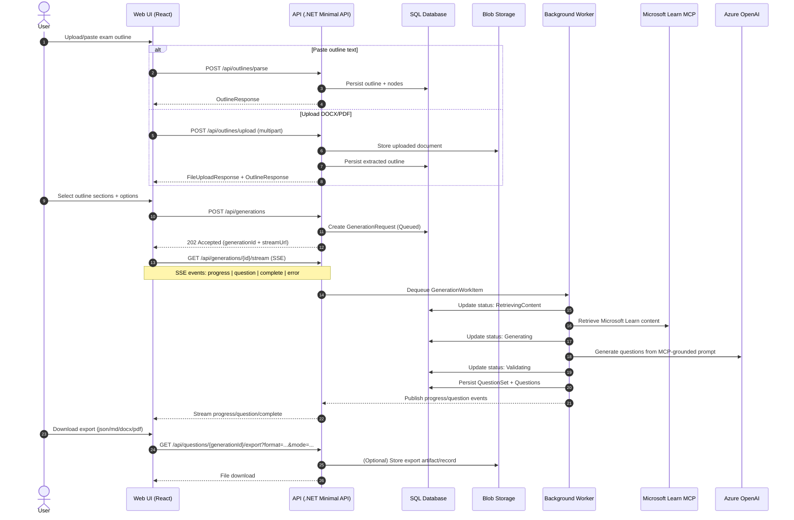
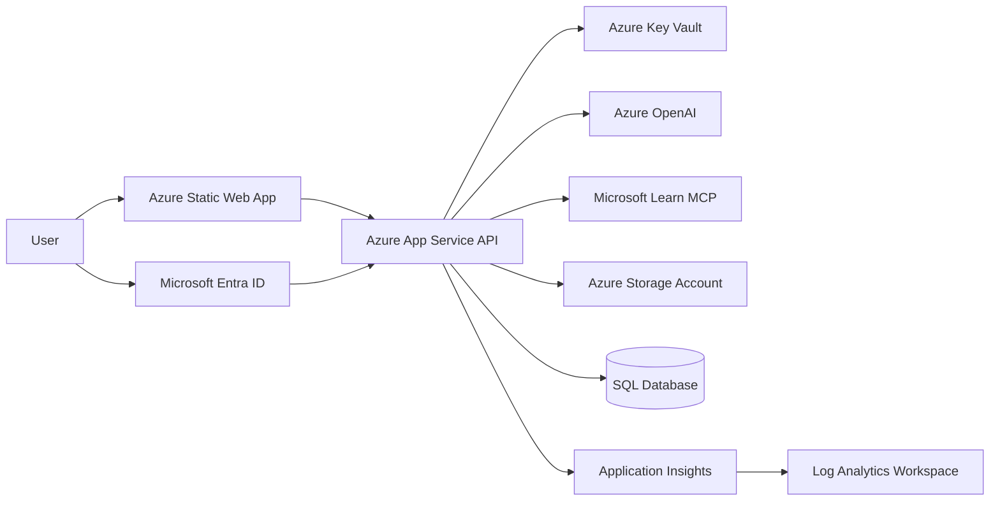

<p align="center">
  
</p>

<h1 align="center">AI Exam Forge</h1>

<p align="center">
  AI-powered exam question generator using Microsoft Learn content through Model Context Protocol (MCP).
</p>

<p align="center">
  <a href="#overview">Overview</a> •
  <a href="#quickstart">Quickstart</a> •
  <a href="#aspire-dashboard-opentelemetry">Aspire Dashboard</a> •
  <a href="#azure-deployment">Azure Deployment</a> •
  <a href="#architecture">Architecture</a> •
  <a href="#documentation">Documentation</a>
</p>

---

## Overview

AI Exam Forge generates high-quality practice exam questions by leveraging Microsoft Learn documentation through the Model Context Protocol (MCP). All question content is derived exclusively from official Microsoft documentation, ensuring accuracy and alignment with certification exam objectives.

### Key Features

- **MCP-Powered Content**: All questions are sourced from Microsoft Learn documentation
- **Multiple Question Types**: Supports various item types including multiple choice, drag-and-drop, and build list
- **Quality Validation**: Automated lint validation ensures compliance with exam writing standards
- **Export Formats**: Export questions as JSON, Markdown, DOCX, or PDF
- **Study/Exam Modes**: Toggle between study mode (with explanations) and exam mode (without)

### Core Objectives

- **Always up-to-date Learn content** without running your own crawler/indexer
- **Query-time retrieval** (“generate questions for AZ-204 storage triggers” and it pulls relevant pages on demand)
- **Better grounding + citation paths** as the MCP server returns sources/URLs/sections
- **Centralized governance**: the backend controls what tools are available, logging, rate limits, prompt injection defenses, etc.

---

## Quickstart

### Prerequisites

| Tool | Version | Purpose |
|------|---------|---------|
| .NET SDK | 10.0.404 (`global.json`) | Backend build; targets remain `net10.0` |
| Aspire CLI | 17.0.0 | Matching dashboard/DCP bundle, required for AppHost builds and runs |
| Node.js / npm | 26.13.0 / 11.20.0 | Frontend tooling, subject to the lockfile restriction below |
| Azure CLI | Latest | Cloud resource management |
| Git | Latest | Version control |

### Dependency refresh status (2026-11-18)

NuGet versions were checked against the configured approved feed,
`https://packagefeedproxy.microsoft.io/nuget/v3/index.json`.

| Direct dependency | Before | After |
|---|---|---|
| Aspire AppHost | Aspire.AppHost.Sdk 13.1.0 | Microsoft.NET.Sdk + Aspire.Hosting.AppHost / Aspire.Hosting.Dotnet 17.0.0 |
| Azure.Extensions.AspNetCore.Configuration.Secrets | 1.3.2 | 1.5.2 |
| Azure.Identity / Azure.Security.KeyVault.Secrets | 1.16.0 / 4.7.0 | 1.21.0 / 4.12.0 |
| Azure.Storage.Blobs / DocumentFormat.OpenXml | 12.26.0 / 3.3.0 | 12.30.1 / 3.5.1 |
| ApplicationInsights.AspNetCore / Microsoft.Identity.Web | 2.23.0 / 3.8.0 | 3.2.0 / 4.18.0 |
| ASP.NET OpenAPI / MVC Testing | 10.0 preview / 10.0.0 | 10.0.15 |
| EF Core / SqlServer / InMemory | 10.0 preview | 10.0.15 |
| Microsoft.Extensions caching, logging, HTTP, hosting and options packages | 10.0.1 | 11.0.0 |
| FluentValidation / NJsonSchema / QuestPDF | 12.1.1 / 11.5.2 / 2025.7.0 | 12.2.0 / 11.6.2 / 2026.9.1 |
| OpenTelemetry hosting, OTLP, ASP.NET, HTTP and runtime | 1.10.0 | 1.21.0 |
| Microsoft.NET.Test.Sdk / coverlet.collector | 17.14.1 / 6.0.4 | 18.12.0 / 10.1.0 |
| FluentAssertions / Moq / xunit.runner.visualstudio | 8.8.0 / 4.20.72 / 3.1.4 | 8.11.0 / 4.21.0 / 4.0.1 |
| Azure.AI.FormRecognizer / Azure.AI.OpenAI / xunit | 4.1.0 / 2.1.0 / 2.9.3 | Unchanged: newest stable versions on the feed |

**Exact holds and unfinished work:**

- **Aspire 17 source migration is complete; signed-package validation is held.**
  Following the [official migration](https://aspire.dev/integrations/dotnet/migrate-dotnet-project-resource/),
  the AppHost uses `Microsoft.NET.Sdk`, explicit AppHost/Dotnet 17.0.0 packages,
  and path-based `AddDotnetProject` for `api` at
  `backend\src\AIExamForge.Api\AIExamForge.Api.csproj`. Only its orchestration-only
  project reference was removed. Default launch-profile selection, external
  endpoints, frontend executable, environment and URL wiring are unchanged.
  AppHost and all consumers remain `net10.0`; service/library references remain.
  The approved-feed 17.0.0 availability hold was not rescanned or bypassed with
  a public NuGet source. See the local-only validation evidence below.
- `OpenTelemetry.Instrumentation.EntityFrameworkCore` remains
  `1.11.0-beta.1`: its approved-feed index has **no stable version**. Other
  OpenTelemetry packages are stable. ASP.NET/EF 11 require `net11.0`, so their
  newest compatible stable versions remain 10.0.15. The updated Extensions 11
  packages support `net10.0`.
- **All npm dependency ranges and the frontend lockfile are held unchanged.**
  Offline inspection found **326** public-registry resolved URLs in
  `frontend/package-lock.json`, despite the effective npm registry being
  `https://packagefeedproxy.microsoft.io/npm/`. Proxy metadata was inspected,
  but no npm install/ci, build, lint or test was run. Do not run installation
  until an authoritative proxy-only lockfile is supplied or its regeneration
  is explicitly approved. Never fetch the existing public URLs or silently
  replace them. The npm commands below apply only after resolving this hold.
- Application Insights 3 replaces removed initializers with an OpenTelemetry
  processor, resource role metadata and scope capture. W3C trace identity is
  retained; the application correlation ID remains a custom dimension.
  Per-event duration is retained as a string property, alongside unchanged
  aggregate metric calls; this is a schema change, detailed below.

### Application Insights 3 event-duration schema

SDK 3's `EventTelemetry` supports `Properties`, not the former `Metrics` bag.
`GenerationCompleted`, `McpRetrieval` and `QuestionSetExported` therefore each
retain `GenerationId` and `DurationMs` together in their event properties.
`DurationMs` is elapsed milliseconds encoded as invariant-culture, round-trip
numeric text (`ToString("R", CultureInfo.InvariantCulture)`), including fractional
milliseconds. It is not automatically supplied by SDK 3.

**The ingestion schema is not identical:** the former SDK 2 numeric
`customMeasurements.DurationMs` moves to SDK 3's string
`customDimensions.DurationMs`. New-only KQL consumers must use
`todouble(customDimensions.DurationMs)`, rather than continue reading the old
measurement field. For a history spanning both SDK versions:

```kusto
customEvents
| where name in ("GenerationCompleted", "McpRetrieval", "QuestionSetExported")
| extend GenerationId = tostring(customDimensions.GenerationId),
         DurationMs = coalesce(todouble(customDimensions.DurationMs),
                               todouble(customMeasurements.DurationMs))
| project timestamp, name, GenerationId, DurationMs
```

In the workspace `AppEvents` table, the corresponding bags are `Properties`
and `Measurements` (`todouble(Properties.DurationMs)` for new events), with
`Name`/`TimeGenerated` instead of `name`/`timestamp`.

The existing aggregate `TrackMetric` calls, values and names are unchanged:
`GenerationDurationMs`, `QuestionsGenerated`, `QuestionsValidated`,
`McpRetrievalDurationMs`, `McpCacheHitRate`, `McpEmptyResultRate`, and
`ExportDurationMs_{format}`. They do not replace the per-generation event value.
Targeted contract coverage captures SDK 3's actual structured `ILogger` event
state and `Meter` measurements through its DI client without starting a host or
exporter. All three event kinds are checked under `en-US` and `fr-FR`, alongside
the existing activity-correlation processor tests. The focused run passed
**8/8** tests (six event/culture cases and two existing correlation cases), using
`--no-restore` and the selector
`FullyQualifiedName~GenerationTelemetryTests|FullyQualifiedName~TelemetryProcessorTests`.

### Aspire 17 local development / compile validation

The official GitHub 17.0.0 Windows x64 CLI reports
`17.0.0+2d325b13709752ba6d9a943635c5e2940a2530c0`; its Authenticode signature and
SHA512 sidecar were verified (archive SHA256
`3d88b09be9cd3d344323b2e3531280954953581adb8102ad50eaf23c67007c05`).
Matching-commit NuGets came from GitHub Actions run **44203911604**, artifact
**14382652960**, `built-nugets`, archive SHA256
`6e522a103ff37924122e9ebea3a8bf33f21b3349e11e0b59bc86ac51cc2a15aa`.
These 17.0.0 NuGets are **unsigned Debug CI artifacts, for LOCAL development
and compile validation only**, not signed production release-package evidence.

Restore used the external validation config's local `Aspire.*` source plus the
approved NuGet proxy, with a unique `NUGET_PACKAGES` cache
(`.tools\aspire17-release\validation-cache-aiexamforge` in the upgrade workspace).
The matching CLI directory was prepended to PATH only for each command;
`ASPIRE_HOME` was isolated to `home-aiexamforge`. Existing global packages were
read-only fallback dependencies. No global NuGet configuration, PATH, SDK or
workload was changed. `DOTNET_CLI_WORKLOAD_UPDATE_NOTIFY_DISABLE` and
`DOTNET_SKIP_FIRST_TIME_EXPERIENCE` were `true`.

NuGet restore writes `packages.lock.json`, but **the local-development AppHost
lock was removed from candidate changes**. Unsigned Debug CI `.nupkg` hashes
**differ** from signed Release packages with the same 17.0.0 IDs/versions; they
cannot be portable signed-release locks. Obsolete untracked 13.6.5 Windows/Linux
locks were also removed. No pre-existing tracked NuGet locks were found or
changed. Other approved-feed locks and lock-generation settings are preserved.
**Generate and review any AppHost release lock only after approved signed
17.0.0 packages arrive.** Do not enable CI locked mode against development
hashes, ignore content-hash mismatches, or publish the local artifacts. Future
local validation must keep development-only locks outside candidate changes.
No machine-absolute feed or expiring artifact download URL is stored in the repo.
CI must provision the matching released CLI 17 bundle before AppHost builds.

Targeted validation used `-m:1 -nr:false`: AppHost build passed with **zero
warnings/errors**, including no legacy Aspire API/SDK warnings; Windows and
Linux-host-property AppHost locked restores passed with the same
**development-only** lock, subsequently removed; these are not signed-release
lock checks.
Contract/telemetry regressions passed **7/7**, rebuilding the API and its
libraries. Earlier dependency-refresh validation passed the solution build and
all **97** backend tests, including coverage; that earlier full-suite result is
not a new Aspire 17 full-suite run. No AppHost/server, browser, container,
publishing, deployment or CI run was launched. Publishing remains unverified;
when authorized, validate with `aspire publish`, not legacy `dotnet run
--operation publish`. npm remains held as described above.

### Local Setup

#### 1. Clone Repository

```bash
git clone https://github.com/swigerb/AIExamForge.git
cd AIExamForge
```

#### 2. Build the solution

```bash
dotnet restore
dotnet build
```

Edit `backend/src/AIExamForge.Api/appsettings.json` with your Azure service endpoints (or provide them via environment variables / Key Vault).

Optional: create a local-only override file at `backend/src/AIExamForge.Api/appsettings.Development.json` (this file is gitignored).

```json
{
  "AzureOpenAI": {
    "Endpoint": "https://your-openai.openai.azure.com/",
    "DeploymentName": "gpt-4-turbo",
    "ApiKey": "your-api-key"
  },
  "BlobStorage": {
    "ConnectionString": "UseDevelopmentStorage=true"
  }
}
```

Environment variable alternatives (recommended for local dev):

- `AzureOpenAI__Endpoint`
- `AzureOpenAI__DeploymentName`
- `AzureOpenAI__ApiKey`

#### 3. Run via Aspire AppHost (recommended)

This starts:

- the Aspire Dashboard
- the API
- the Vite frontend (if Node/npm are installed and `frontend/` dependencies are installed)

```bash
dotnet run --project backend/src/AIExamForge.AppHost
```

Then open the frontend from the Aspire dashboard (look for **Open Frontend**).

#### 4. Run API (standalone)

```bash
# From repo root:
cd backend/src/AIExamForge.Api
dotnet run

# API available at: http://localhost:5180
# OpenAPI document (Development only): http://localhost:5180/openapi/v1.json
# HTTPS is available via the "https" launch profile if you want it.
```

### Aspire Dashboard (OpenTelemetry)

When running in Development, the API exports OpenTelemetry traces/logs/metrics via OTLP so you can view:

- UI → API requests (ASP.NET Core + HttpClient instrumentation)
- MCP retrieval spans (custom spans: `mcp.query` and `mcp.tools.call`)

By default, the API exports OTLP over gRPC to `http://localhost:18889`.

#### 1. Start the Aspire Dashboard

Option A: With the matching Aspire 17 CLI on PATH and approved packages restored,
start the AppHost; its dashboard/DCP come from the CLI bundle:

```bash
dotnet run --project backend/src/AIExamForge.AppHost
```

Option B: For API-only OTLP troubleshooting, the independently hosted legacy
dashboard below requires Docker Desktop. It is not the Aspire 17 AppHost bundle
and was not launched or validated by this migration:

```bash
docker run --rm -it -p 18888:18888 -p 18889:18889 mcr.microsoft.com/dotnet/aspire-dashboard:13.6.5
```

#### 2. Run the API (Development)

Start the API using the `http` or `https` launch profile. The repo includes Development defaults in the launch profile:

- `OTEL_EXPORTER_OTLP_ENDPOINT=http://localhost:18889`
- `OTEL_EXPORTER_OTLP_PROTOCOL=grpc`
- `OTEL_TRACES_SAMPLER=always_on`

You can override these with environment variables, or with:

- `OpenTelemetry:Enabled`
- `OpenTelemetry:OtlpEndpoint`

#### 3. View traces in the dashboard

Open the dashboard UI:

- <http://localhost:18888>

Look for the service:

- `AIExamForge.Api`

Useful spans/tags to filter on:

- Span names: `mcp.query`, `mcp.tools.call`
- Tag: `mcp.tool.name` (tool being called)
- Tag: `mcp.query_id` (correlates all tool calls for one query)

#### 5. Frontend Setup (standalone)

```bash
cd frontend
npm install
echo "VITE_API_BASE_URL=http://localhost:5180/api" > .env.development
npm run dev

# App available at: http://localhost:5173
```

Note: `frontend/.env.development` is gitignored. Use it for your local API URL.

### Verify Setup

```bash
# Backend health check
curl http://localhost:5180/health
```

### Running Tests

```bash
# Backend tests
dotnet test

# Frontend tests
cd frontend
npm test
```

Frontend tests are executed with Vitest.

### Common Issues

| Issue | Solution |
|-------|----------|
| Database connection failed | Ensure SQL Server LocalDB is installed and running |
| Azurite connection failed | Run `azurite --silent` in a separate terminal |
| MCP service unavailable | Verify network connectivity to Microsoft Learn |
| Azure OpenAI rate limited | Wait for reset or increase TPM quota |

---

## Azure Deployment

AIExamForge is configured for deployment using the [Azure Developer CLI (azd)](https://learn.microsoft.com/azure/developer/azure-developer-cli/).

### Prerequisites

1. **Azure Developer CLI** - Install from [aka.ms/azd-install](https://aka.ms/azd-install)
2. **Azure subscription** - With permissions to create resources
3. **.NET SDK 10.0.404** - For building the backend
4. **Node.js 26.13.0 / npm 11.20.0** - For building the frontend after the lockfile hold is resolved

### Deploy with `azd up`

The `azd up` command provisions all Azure resources and deploys the application in a single step:

```bash
# Login to Azure
azd auth login

# Initialize and deploy (first time)
azd up
```

You'll be prompted to:
- Select an Azure subscription
- Choose a deployment region
- Provide an environment name (e.g., `dev`, `prod`)

### What Gets Deployed

| Resource | Description |
|----------|-------------|
| **Azure App Service** | Hosts the .NET API backend |
| **Azure Static Web App** | Hosts the React frontend |
| **Azure OpenAI Service** | Powers question generation (GPT-4) |
| **Azure Key Vault** | Securely stores secrets and API keys |
| **Azure Storage Account** | Stores uploaded outlines and generated content |
| **Application Insights** | Monitoring and diagnostics |
| **Log Analytics Workspace** | Centralized logging |

### Common `azd` Commands

```bash
azd deploy              # Deploy code changes only (skip infrastructure)
azd show                # View deployed resources
azd monitor --overview  # Open the deployed application in browser
azd down                # Tear down all resources
azd env set VAR value   # Set environment variables
azd env list            # View current environment
```

### Environment Configuration

After deployment, configure secrets in Azure Key Vault:

```bash
# Get the Key Vault name
azd env get-values | grep AZURE_KEY_VAULT_NAME

# Add secrets via Azure CLI
az keyvault secret set --vault-name <your-keyvault> --name "AzureOpenAI--ApiKey" --value "<your-key>"
```

### Cost Considerations

| Resource | Default Tier |
|----------|--------------|
| App Service | Basic (B1) |
| Static Web App | Free |
| Azure OpenAI | Pay-as-you-go |
| Storage | Standard LRS |

For production workloads, consider upgrading the App Service plan and enabling autoscaling.

---

## Architecture

### Process Flow
1.	Frontend calls backend API: “Generate 15 questions for topic X”
2.	Backend API calls the AI model with tool access enabled
3.	AI Model calls MCP tools like “search docs” / “get page” with Microsoft Learn MCP server
4.	Backend receives tool results, model generates questions grounded in that content
5.	Backend returns JSON to Frontend

- Frontend (Vite/TS/React): purely UI
-	Backend API (ASP.NET Core):
    - authenticates user
    - calls AI LLM
    -	enables tool calling to Microsoft Learn MCP server
    -	validates and post-processes output (lint rules, schema validation, dedupe)
    -	stores results and citations
    - generates DOCX/MD/PDF/JSON output of questions

### Application Flow (Mermaid)



### Deployment Architecture (Mermaid)



AIExamForge follows Clean Architecture principles:

```
backend/
├── src/
│   ├── AIExamForge.Api/           # HTTP API endpoints
│   ├── AIExamForge.Application/   # Business logic and services
│   ├── AIExamForge.Domain/        # Domain entities and value objects
│   └── AIExamForge.Infrastructure/ # External dependencies (DB, MCP, Storage)
└── tests/
    ├── AIExamForge.UnitTests/
    ├── AIExamForge.IntegrationTests/
    └── AIExamForge.ContractTests/

frontend/
└── src/
    ├── components/    # Reusable UI components
    ├── pages/         # Route pages (wizard steps)
    ├── types/         # TypeScript type definitions
    └── api/           # API client
```

### MCP Dependency

AIExamForge relies on the Model Context Protocol (MCP) to retrieve content from Microsoft Learn documentation. MCP provides structured access to Microsoft's official documentation, ensuring all generated questions are grounded in authoritative sources.

**Content Limitations**: Questions are limited to topics documented in Microsoft Learn. Content not yet published, recently updated, or region-specific may have limited coverage.

| Scenario | Recovery Action |
|----------|-----------------|
| MCP timeout | Reduce topic scope, retry |
| MCP unavailable | Wait 5-10 minutes, retry |
| Empty results | Verify topic names match Microsoft Learn |
| Rate limited | Wait as indicated, retry |

---

## Configuration

### Required Settings

| Setting | Description |
|---------|-------------|
| `ConnectionStrings:DefaultConnection` | SQL Server connection string |
| `AzureOpenAI:Endpoint` | Azure OpenAI service endpoint |
| `AzureOpenAI:ApiKey` | Azure OpenAI API key |

### Optional Settings

| Setting | Description | Default |
|---------|-------------|---------|
| `DatabaseSettings:CommandTimeout` | SQL command timeout (seconds) | 30 |
| `ApplicationInsights:ConnectionString` | App Insights telemetry | (disabled) |
| `KeyVault:VaultUri` | Azure Key Vault URI | (disabled) |

---

## Documentation

- [Exam Writing Style Guide](docs/exam-writing-style-guide.md) - Question authoring standards
- [Style Governance](docs/style-governance.md) - Style precedence rules
- [Data Model](specs/001-generate-questions/data-model.md) - Entity definitions
- [API Contracts](specs/001-generate-questions/contracts/) - OpenAPI specification
- [Item Types](docs/item-types.md) - Supported question types

---

## License

Licensed under the MIT License. See [LICENSE](LICENSE).

## Contributing

Please read the contribution guidelines before submitting pull requests.

## Disclaimer

AIExamForge generates practice exam questions based on Microsoft Learn content. These questions are:

- **Not actual exam questions**: All content is original practice material
- **Not endorsed by Microsoft**: This is an independent educational tool
- **Subject to content limitations**: Questions are limited to topics covered in Microsoft Learn
- **For practice only**: Not intended to represent actual certification exam content or difficulty
